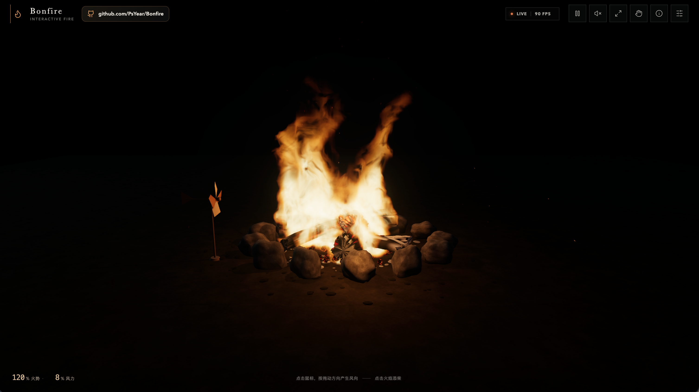

# Bonfire

Bonfire 是一个运行在浏览器中的实时交互式篝火体验。项目使用 WebGL2 与 Three.js
渲染体积火焰、烟雾、余烬、热折射、程序化木柴和动态火光，并将鼠标、键盘、
摄像头手势与自然语言 Agent 统一为同一套场景控制方式。

[🔥Bonfire 体验链接](https://bonfire-azure.vercel.app/) ·
[🎬 说明视频](https://youtu.be/alcO1KfJUCs) ·

> 在线体验部署于 Vercel，特定网络环境可能需要科学上网。

## 预览效果

[](https://bonfire-azure.vercel.app/)


## 设计思路

Bonfire 的目标不是简单播放一段火焰动画，而是构建一个能持续观看、可直接操控、
并能对自然语言指令作出反馈的实时篝火空间。

- **真实感优先**：火焰、烟雾、火星、木柴热解、炭火红热与动态光照共享场景状态，
  避免互相脱节的视觉特效。
- **直接操控**：点击添柴、拖动改变风向、方向键调整火势，让交互结果立即反馈到画面。
- **多模态输入**：鼠标、键盘、摄像头手势、参数面板和 AI Agent 均可控制同一套参数。
- **沉浸与克制**：默认界面保持低干扰，控制面板可以收起，并提供沉浸模式与真实篝火声音。
- **可验证迭代**：设计、技术决策、用户反馈和每轮修改都保留在 `prd/` 与完整迭代记录中。

更完整的产品洞察与技术方案见：

- [初始需求](./prd/01-init_basic)
- [产品洞察与交互设计](./prd/02-insight)
- [实时渲染技术方案](./prd/03-tech_info)
- [与 AI 协作的完整迭代记录](./prd/04-完整迭代交互记录.txt)

## 交互介绍

### 场景操作

| 操作 | 效果 |
| --- | --- |
| 单击篝火场景 | 添柴助燃，火势增加 10 个百分点并激起火星 |
| 按住鼠标左键拖动 | 根据拖动方向改变风向，松开后保留当前方向 |
| `↑` / `↓` | 每次增加或减少 10 个百分点火势 |
| `←` / `→` | 每次转动 10° 风向，并接管自动风向 |
| `Command/Ctrl + Z` | 撤销上一步参数修改 |

### 顶部与控制面板

- 暂停或继续场景动画。
- 开启真实木柴噼啪声与强风空气声。
- 进入沉浸模式，隐藏界面控件。
- 打开摄像头手势控制：掌心朝上托举加火，掌心朝下压动减火。
- 在「调节」面板修改火势、风力、风向、火焰颜色、烟雾、火星、环境光、音量和画质。
- 使用温暖陪伴、深夜余烬、旺盛篝火等场景预设快速切换氛围。

摄像头画面只在本地通过 MediaPipe 识别，不会上传；关闭手势控制后会立即释放摄像头。

### AI Agent

在 Agent 面板中输入自己的智谱 API Key，即可通过自然语言连续调整场景。API Key
仅随当前请求转发给模型服务，项目服务端不保存 Key。

示例指令：

```text
帮我做一个适合魔兽世界荒野营地的篝火
只把火焰改成邪能绿色，其他参数保持不变
左吹 1 秒，右吹 1 秒，循环
火势更小一点，炭火保持明亮
恢复默认篝火
```

Agent 使用结构化工具修改场景参数，并支持多轮上下文、Token 用量显示和撤销。

## 项目路径

| 内容 | 仓库路径 |
| --- | --- |
| 项目根目录 | `./` |
| 前端代码 | [`frontend/`](./frontend) |
| 设计与技术文档 | [`prd/`](./prd) |
| AI 迭代记录 | [`prd/04-完整迭代交互记录.txt`](./prd/04-完整迭代交互记录.txt) |
| 项目预览图 | [`assets/bonfire-preview.png`](./assets/bonfire-preview.png) |

```text
Bonfire/
├── assets/                         # README 使用的项目预览资源
├── frontend/                       # Vite + TypeScript + Three.js 应用
│   ├── api/                        # Vercel API 入口
│   ├── public/                     # 图标、音频与手势识别资源
│   ├── server/                     # Agent 协议与模型转发
│   └── src/                        # 场景、交互、音频与 UI 源码
└── prd/                            # 产品思路、技术方案与迭代记录
```

## 技术概览

- Vite、TypeScript、Three.js
- WebGL2 体积火焰与 GPU 场模拟
- 程序化木柴、燃烧表面、烟雾与火星
- Web Audio API 篝火声音
- MediaPipe Hand Landmarker 本地手势识别
- GLM 5.3 Flash 场景 Agent
- Vercel 静态站点与 Serverless API

## 本地运行

需要 Node.js 22 或更高版本。

```bash
cd frontend
npm ci
npm run dev:api
```

另开一个终端：

```bash
cd frontend
npm run dev
```

浏览器打开 <http://127.0.0.1:5173>。篝火渲染与基础交互无需 API Key；只有 Agent
对话需要在页面中配置智谱 API Key。更完整的开发、构建和技术说明见
[`frontend/README.md`](./frontend/README.md)。

## 项目视频

项目思路、交互方式与迭代过程介绍：

[在 YouTube 观看 Bonfire 项目说明视频](https://youtu.be/alcO1KfJUCs)
